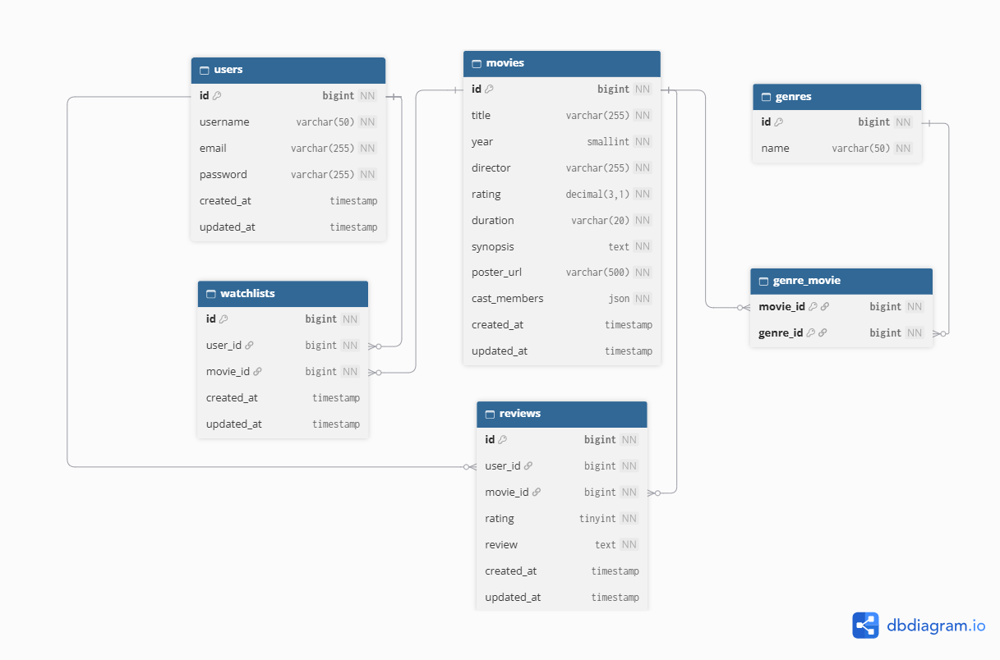

# FilmLog Backend — Movie Watchlist API

Backend REST API untuk platform watchlist dan review film (terinspirasi Letterboxd dan IMDb), dibuat untuk **GDGoC UGM Open Recruitment — Back-End Assignment**.

Fitur: registrasi dan login dengan **JWT**, katalog film, watchlist pribadi, riwayat tontonan dengan rating dan review, serta **rekomendasi film berbasis Google Gemini yang dibatasi pada database lokal**.

> Repo ini adalah fork dari [movie-watchlist-starter](https://github.com/bimoar07/movie-watchlist-starter). Folder `frontend/` adalah frontend pendamping bawaan starter dan **tidak diubah**. Seluruh pekerjaan backend ada di folder `backend/`.

**Penulis:** `Keisha Amanda Setiawan` · **Video walkthrough:** `https://drive.google.com/drive/folders/1UPFhZGsKXq1s1c8dyzAUWv_kHB5s0TKn?usp=sharing` · **API Documentation:** `https://documenter.getpostman.com/view/58559011/2sBYHYuJEH`  

---

## Daftar Isi

1. [Tech Stack](#tech-stack)
2. [Struktur Repo](#struktur-repo)
3. [Prasyarat](#prasyarat)
4. [Instalasi dan Menjalankan](#instalasi-dan-menjalankan)
5. [Variabel Environment](#variabel-environment)
6. [Migrasi dan Seeder](#migrasi-dan-seeder)
7. [Menjalankan Frontend](#menjalankan-frontend)
8. [Dokumentasi API](#dokumentasi-api)
9. [Desain Database (ERD)](#desain-database-erd)
10. [Keamanan dan Penanganan Error](#keamanan-dan-penanganan-error)
11. [Integrasi Gemini dan Grounding](#integrasi-gemini-dan-grounding)
12. [Keputusan Desain dan Trade-off](#keputusan-desain-dan-trade-off)
13. [Testing](#testing)
14. [Troubleshooting](#troubleshooting)

---

## Tech Stack

| Komponen | Pilihan |
|---|---|
| Bahasa / framework | PHP 8.3 / Laravel |
| Database | MySQL (SQLite dipakai untuk test otomatis) |
| Autentikasi | JWT (HS256) lewat [`firebase/php-jwt`](https://github.com/firebase/php-jwt), middleware buatan sendiri |
| Hashing password | bcrypt (`Hash::make`) |
| LLM | Google Gemini (REST `generateContent`, structured output) |
| Testing | PHPUnit (via `php artisan test`) |
| Dokumentasi API | Postman collection |

## Struktur Repo

```
.
├── data/                  # movies.json & seed.sql dari starter pack
├── frontend/              # frontend pendamping (bawaan starter, tidak diubah)
└── backend/               # <- proyek Laravel
    ├── app/
    │   ├── Exceptions/    # GeminiException
    │   ├── Http/
    │   │   ├── Controllers/   # Auth, Movie, Watchlist, Watched
    │   │   ├── Middleware/    # JwtAuthenticate, ForceJsonResponse, RejectMalformedJson
    │   │   ├── Requests/      # Form Request (validasi input)
    │   │   └── Resources/     # bentuk JSON keluaran
    │   ├── Models/        # User, Movie, Genre, GenreMovie, Watchlist, Review
    │   └── Services/      # JwtService, GeminiService, MovieRecommendationService
    ├── config/            # jwt.php, gemini.php
    ├── database/          # migrations & seeders
    ├── routes/api.php
    └── tests/             # 74 feature test
```

## Prasyarat

- **PHP 8.3** dengan ekstensi `pdo_mysql`, `mbstring`, `openssl`, `curl`, `fileinfo`
  (untuk menjalankan test: `pdo_sqlite`)
- **Composer** 2.10.3
- **MySQL 8.4.3**. Versi lebih lama mengabaikan CHECK constraint rating secara diam-diam; aplikasi tetap berjalan karena validasi juga dilakukan di Laravel
- **API key Gemini** gratis dari <https://aistudio.google.com> (menu *Get API key*)
- Git

Pengguna Windows dapat memakai [Laragon](https://laragon.org), yang sudah menyertakan PHP, Composer, dan MySQL.

## Instalasi dan Menjalankan

Semua perintah di bawah dijalankan dari folder `backend/`.

```bash
# 1. Clone repo
git clone <https://github.com/vlanz7/movie-watchlist-starter>
cd movie-watchlist-starter/backend

# 2. Pasang dependensi
composer install

# 3. Salin file environment dan buat APP_KEY
cp .env.example .env            # Windows (cmd/PowerShell): copy .env.example .env
php artisan key:generate

# 4. Buat kunci rahasia JWT, lalu tempel ke JWT_SECRET di .env
php -r "echo bin2hex(random_bytes(32));"

# 5. Buat database kosong di MySQL
mysql -u root -e "CREATE DATABASE movie_watchlist CHARACTER SET utf8mb4 COLLATE utf8mb4_unicode_ci;"

# 6. Isi .env (lihat bagian Variabel Environment), lalu migrasi + seed
php artisan migrate --seed

# 7. Jalankan server
php artisan serve               # http://localhost:8000
```

API tersedia di **`http://localhost:8000/api`**. Cek cepat: buka <http://localhost:8000/api/movies>, harus tampil 20 film.

> **Penting:** seeder membaca `../data/movies.json`, jadi struktur folder repo (`data/` sejajar dengan `backend/`) harus dipertahankan.

## Variabel Environment

Salin `.env.example` menjadi `.env`, lalu isi minimal variabel bertanda ✱.
| Variabel | Contoh | Keterangan |
|---|---|---|
| `APP_KEY` ✱ | `base64:...` | Dibuat oleh `php artisan key:generate` |
| `DB_CONNECTION` ✱ | `mysql` | |
| `DB_HOST` / `DB_PORT` ✱ | `127.0.0.1` / `3306` | |
| `DB_DATABASE` ✱ | `filmlog_db` | Database harus sudah dibuat |
| `DB_USERNAME` / `DB_PASSWORD` ✱ | `root` / *(kosong di Laragon)* | |
| `SESSION_DRIVER` ✱ | `file` | Tabel `sessions` tidak dipakai (API stateless) |
| `JWT_SECRET` ✱ | *(64 karakter hex)* | Kunci penandatangan token. **Rahasia, jangan di-commit** |
| `JWT_TTL` | `1440` | Masa berlaku token dalam menit (24 jam) |
| `GEMINI_API_KEY` ✱ | `...` | Dari Google AI Studio. **Rahasia** |
| `GEMINI_MODEL` | `gemini-3.5-flash-lite` | Nama model; ada di `.env` karena model sering berganti atau ditutup |
| `GEMINI_FALLBACK_MODEL` | *gemini-3.6-flash" | Opsional: model cadangan saat model utama sedang kewalahan (503) |
| `GEMINI_TIMEOUT` | `30` | Batas tunggu jawaban Gemini (detik) |

Contoh blok yang perlu ada di `.env`:

```env
DB_CONNECTION=mysql
DB_HOST=127.0.0.1
DB_PORT=3306
DB_DATABASE=filmlog_db
DB_USERNAME=root
DB_PASSWORD=

SESSION_DRIVER=file

JWT_SECRET=hasil_random_bytes_64_karakter
JWT_TTL=1440

GEMINI_API_KEY=api_key_anda
GEMINI_MODEL=gemini-3.5-flash-lite
GEMINI_FALLBACK_MODEL=gemini-3.6-flash
GEMINI_TIMEOUT=30
```

> Tanpa `GEMINI_API_KEY`, semua endpoint tetap berjalan; hanya `POST /api/movies/recommend` yang membalas `503` ("Layanan AI belum dikonfigurasi").

## Migrasi dan Seeder

```bash
php artisan migrate --seed          # buat tabel + isi data
php artisan migrate:fresh --seed    # ulang dari nol (MENGHAPUS semua data)
php artisan db:seed                 # hanya seeder (aman dijalankan berulang)
```

Hasil seeding yang benar: **20 film, 15 genre, 49 relasi film-genre**. Seeder (`MovieSeeder`) bersifat **idempotent**: dijalankan berkali-kali tidak membuat data ganda (memakai `upsert`, dibungkus transaksi).

## Menjalankan Frontend

Frontend bawaan starter bersifat *zero-build*, tidak perlu `npm install`.

```bash
cd frontend
```

## Dokumentasi API

Koleksi Postman lengkap (27 request, deskripsi, contoh response, dan test otomatis) ada di
[`https://documenter.getpostman.com/view/58559011/2sBYHYuJEH`](https://documenter.getpostman.com/view/58559011/2sBYHYuJEH).
Import ke Postman, jalankan **1. Auth > Register**, dan token tersimpan otomatis untuk request lain.

Ringkasan endpoint (prefix `/api`):

| Method | Endpoint | Auth | Keterangan | Status |
|---|---|:---:|---|---|
| POST | `/auth/register` | | Daftar; mengembalikan `token` + `user` | 201, 409, 422 |
| POST | `/auth/login` | | Login; mengembalikan `token` | 200, 401, 422, 429 |
| GET | `/auth/me` | ✔ | User pemilik token (berguna untuk uji token) | 200, 401 |
| GET | `/movies` | | Daftar film. Opsional: `?genre=`, `?search=`, `?shuffle=1` | 200 |
| GET | `/movies/{id}` | | Detail film | 200, 404 |
| POST | `/movies/recommend` | | Rekomendasi AI. Body: `{ "prompt": "..." }` | 200, 422, 429, 502, 503, 504 |
| GET | `/watchlist` | ✔ | Watchlist milik user | 200, 401 |
| POST | `/watchlist` | ✔ | Tambah film. Body: `{ "movieId": 1 }` | 201, 404, 409, 422 |
| DELETE | `/watchlist/{movieId}` | ✔ | Hapus film dari watchlist | 200, 404 |
| GET | `/watched` | ✔ | Riwayat tontonan, terbaru di atas | 200, 401 |
| POST | `/watched` | ✔ | Catat tontonan. Body: `{ "movieId": 1, "rating": 5, "review": "..." }` | 201, 404, 422 |

Endpoint bertanda ✔ memerlukan header `Authorization: Bearer <token>`.

**Format error** selalu JSON: `{ "message": "...", "errors": { "field": ["..."] } }` (`errors` hanya untuk 422).

**Kode status yang dipakai**

| Kode | Dipakai untuk |
|---|---|
| 400 | Body JSON rusak (tidak bisa dibaca) |
| 401 | Token tidak ada / tidak valid / kedaluwarsa; email atau password salah |
| 404 | Film atau entri tidak ditemukan (termasuk `movieId` yang tidak ada) |
| 409 | Duplikat (film sudah ada di watchlist; email/username bentrok di level database) |
| 422 | Validasi input gagal |
| 429 | Terlalu banyak request, atau kuota Gemini habis |
| 502 / 503 / 504 | Jawaban AI tidak valid / AI sibuk atau belum dikonfigurasi / timeout |

Kode **403 sengaja tidak dipakai**: semua query dibatasi ke user pemilik token, sehingga data milik user lain tidak pernah terjangkau dan hasilnya 404. Ini juga menghindari kebocoran informasi bahwa data tersebut ada.

## Desain Database (ERD)


**Relasi Users, Watchlist, dan Reviews**

- `watchlists` dan `reviews` adalah tabel penghubung many-to-many antara `users` dan `movies`, masing-masing dengan atribut sendiri. Satu user punya satu watchlist implisit (kontrak API tidak mengenal id daftar), sehingga tidak diperlukan tabel "header" watchlist.
- `watchlists` memiliki **UNIQUE (user_id, movie_id)**: film yang sama tidak bisa masuk dua kali. Constraint ini menjadi penjaga terakhir untuk respons 409, termasuk saat dua request datang bersamaan.
- `reviews` **sengaja tanpa UNIQUE**: setiap baris adalah satu kali menonton (model *diary*). Lihat [Keputusan Desain](#keputusan-desain-dan-trade-off).
- Semua foreign key memakai `ON DELETE CASCADE`. Genre dinormalisasi lewat pivot `genre_movie` (primary key komposit).
- Constraint tambahan: `CHECK (rating BETWEEN 1 AND 5)` pada `reviews` (MySQL/MariaDB/PostgreSQL).
- Indeks: foreign key (otomatis oleh MySQL) dan UNIQUE pada `users.email`, `users.username`, `genres.name`, serta `watchlists (user_id, movie_id)`. Tidak ada indeks tambahan karena belum ada query yang membutuhkannya (20 film; pencarian memakai `LIKE '%…%'` yang tidak memakai indeks biasa).

## Keamanan dan Penanganan Error

| Aspek | Implementasi | Lokasi |
|---|---|---|
| **Hashing password** | bcrypt via `Hash::make` saat register, `Hash::check` saat login. Password maksimal 72 karakter (batas bcrypt) | `AuthController` |
| **Pembuatan token** | JWT HS256 berisi `sub`, `iat`, `exp`; secret dan TTL dari `.env` | `JwtService` |
| **Validasi token** | Header Bearer, tanda tangan, masa berlaku, dan keberadaan user dicek di setiap request terlindungi. Algoritma di-*pin* ke HS256 sehingga token `alg: none` ditolak | `JwtAuthenticate` |
| **Validasi input** | Form Request per endpoint (tipe, panjang, rentang rating 1–5, email unik, dst.) dengan pesan berbahasa Indonesia | `app/Http/Requests` |
| **Isolasi data** | Semua query watchlist/review dimulai dari `$request->user()`. `user_id` **bukan** field *fillable*, jadi pemilik data selalu dari token, bukan dari body | Controller + Model |
| **Anti user-enumeration** | Login gagal selalu menjawab "Email atau password salah", baik email tidak ada maupun password salah | `AuthController` |
| **Brute-force** | `throttle:10,1` pada login dan rekomendasi AI | `routes/api.php` |
| **Response konsisten** | Semua error `api/*` berupa JSON, walau klien tidak mengirim `Accept: application/json`. JSON rusak dibalas 400 | `ForceJsonResponse`, `RejectMalformedJson`, `bootstrap/app.php` |
| **Rahasia** | `JWT_SECRET` dan `GEMINI_API_KEY` hanya di `.env` (tidak di-commit). Kunci Gemini dikirim lewat header, bukan URL | `.gitignore`, `GeminiService` |
| **Foreign key tidak valid** | `movieId` yang tidak ada dibalas 404 yang jelas, bukan error database 500 | Controller |
| **Detail error eksternal** | Pesan mentah dari Gemini hanya masuk log server, tidak dikirim ke klien | `GeminiService` |

## Integrasi Gemini dan Grounding

Endpoint: `POST /api/movies/recommend` dengan body `{ "prompt": "mind-bending sci-fi thriller" }`.

Respons: `{ "movie_id": 1, "reasoning": "...", "movie": { ... } }`

Tantangannya: model bahasa cenderung menyebut film yang ia kenal dari pengetahuannya sendiri, padahal katalog hanya berisi 20 film. Karena itu grounding dilakukan **empat lapis**:

1. **Konteks dari database.** Seluruh katalog (id, judul, tahun, sutradara, genre, sinopsis) diambil dari database dan dimasukkan ke prompt. Dengan 20 film ini murah (kira-kira 2–3 ribu token).
2. **Instruksi keras.** *System instruction* menetapkan aturan: hanya boleh memilih dari daftar, tepat satu film, id persis seperti di daftar, alasan hanya dari data film, dan jawaban dalam bahasa yang sama dengan permintaan. Input pengguna dipisah dalam tag `<permintaan_pengguna>` dan ditegaskan sebagai **data, bukan perintah**. Tag penutup yang diketik pengguna dibuang agar tidak bisa keluar dari pembungkus (*prompt injection*).
3. **Format terstruktur.** `responseMimeType: application/json` dan `responseSchema` memaksa keluaran `{ movie_id: integer, reasoning: string }`.
4. **Verifikasi di server.** Jawaban AI tidak dipercaya begitu saja: `movie_id` dicocokkan dengan database. Jika tidak ada (halusinasi), permintaan diulang sekali; jika tetap salah, respons `502`.

Lapis 1–3 menurunkan peluang halusinasi; hanya lapis 4 yang **menjamin** film yang dikembalikan benar-benar ada.

**Ketahanan terhadap kegagalan layanan eksternal**

- Gangguan sementara di sisi Google (500/502/503/504) dicoba ulang otomatis hingga 3 kali; opsional pindah ke `GEMINI_FALLBACK_MODEL`.
- Kuota habis (429) tidak diulang; timeout dibatasi `GEMINI_TIMEOUT`.
- Nama model dan *thinking level* ada di `.env`, sehingga penggantian model tidak memerlukan perubahan kode.

**Batas desain:** memasukkan seluruh katalog ke prompt cocok untuk puluhan hingga ratusan film. Untuk katalog besar, strategi yang tepat adalah pra-filter (genre atau *embedding*) sebelum prompt dibangun.

## Keputusan Desain dan Trade-off

| Keputusan | Alasan |
|---|---|
| **Genre dinormalisasi** (`genres` + pivot), `cast` disimpan sebagai JSON, `director` sebagai string | Genre berulang dan berpotensi difilter; `cast` hanya ditampilkan, tidak pernah dikueri, sehingga normalisasi tidak memberi manfaat nyata. Jika kelak perlu pencarian per aktor, `cast` bisa dimigrasikan ke tabel `people` |
| **Review berupa diary** (tanpa UNIQUE per user–film) | Frontend tidak memiliki fitur edit/hapus review dan menampilkan tiap entri sebagai kartu tersendiri. Film yang sama boleh dicatat lebih dari sekali (menonton ulang) |
| **Watchlist tidak dihapus otomatis saat film dicatat sebagai ditonton** | Itu perilaku tampilan yang dikelola klien. Backend menyediakan operasi atomik yang terpisah (`DELETE /watchlist/{id}`) |
| **`username` unik** | Mencegah dua akun dengan nama tampilan sama. Konsekuensinya, bentrok username dibalas 422 dan pengguna memilih nama lain |
| **JWT stateless tanpa tabel token** | Sederhana dan cukup untuk lingkup tugas. Konsekuensi: token tidak bisa dicabut sebelum kedaluwarsa dan tidak ada refresh token |
| **Middleware JWT buatan sendiri** (`firebase/php-jwt`) | Ringan dan mudah dijelaskan baris per baris, tanpa tabel tambahan seperti Sanctum |
| **Endpoint rekomendasi publik + throttle** | Modul menempatkannya di grup Movies; throttle melindungi kuota Gemini gratis |
| **Validasi 422 (bukan 400) untuk input tidak valid** | Konvensi Laravel; 400 dipakai khusus untuk body JSON yang tidak terbaca |
| **Resource API** (`MovieResource`, dst.) | Memisahkan bentuk JSON keluaran dari skema database; genre diratakan menjadi array nama dan `cast_members` dipetakan ke `cast` agar sama dengan `movies.json` |
| **Seeder memakai `movies.json`, bukan `seed.sql`** | `seed.sql` bersintaks PostgreSQL (`SERIAL`, `ON CONFLICT`) dan tidak kompatibel dengan MySQL |

## Testing

```bash
php artisan config:clear
php artisan test
```

Terdapat **74 feature test** yang mencakup:

- **Auth guard**: tanpa token, token rusak, tanda tangan palsu, token kedaluwarsa, token milik user yang sudah dihapus
- **Registrasi dan login**: password ter-hash, normalisasi email, duplikat, pesan login seragam, JSON rusak (400)
- **Logika bisnis**: duplikat watchlist (409), foreign key tidak valid (404), validasi rating 1–5, `user_id` dari token (bukan body), **isolasi data antar user**
- **Database**: seeder (20/15/49) dan idempotensinya, cast model, UNIQUE di level database, cascade delete
- **Gemini** (respons dipalsukan dengan `Http::fake`, tanpa internet atau API key): isi prompt ter-*grounding* ke katalog, kunci di header bukan URL, tag injection dibuang, id halusinasi ditolak, retry, 429/503, detail error tidak bocor

Test berjalan di **SQLite in-memory**, terpisah dari database MySQL. `ApiTestCase` menolak berjalan jika terarah ke database selain itu, karena `RefreshDatabase` menghapus semua tabel.

## Troubleshooting

| Gejala | Penyebab / solusi |
|---|---|
| `SQLSTATE ... Unknown database` | Database belum dibuat. Jalankan perintah `CREATE DATABASE` di langkah instalasi |
| `File dataset tidak ditemukan` saat seed | Struktur folder berubah. `data/movies.json` harus sejajar dengan folder `backend/` |
| `JWT_SECRET belum diatur di file .env` | Isi `JWT_SECRET`, lalu `php artisan config:clear` |
| Semua request terlindungi mengembalikan 401 | Header harus `Authorization: Bearer <token>` (ada satu spasi setelah `Bearer`) |
| Rekomendasi AI `503` "Layanan AI belum dikonfigurasi" | `GEMINI_API_KEY` kosong |
| Rekomendasi AI `503` "sedang sibuk" | Model Google sedang kewalahan; coba lagi sebentar, atau isi `GEMINI_FALLBACK_MODEL` |
| Rekomendasi AI `502` dan log menyebut 404 | Nama model di `GEMINI_MODEL` tidak tersedia untuk akun Anda; pilih model lain dari Google AI Studio |
| Rekomendasi AI `504` | Timeout; periksa koneksi, naikkan `GEMINI_TIMEOUT`, atau turunkan `GEMINI_THINKING_LEVEL` ke `low` |
| `Table 'sessions' doesn't exist` | Set `SESSION_DRIVER=file` di `.env` |
| Browser memblokir request dari frontend (CORS) | Pastikan memanggil path berawalan `/api`; jika perlu `php artisan config:publish cors` dan cek `allowed_origins` |
| `php artisan test` berhenti dengan pesan "demi keamanan" | `phpunit.xml` harus memakai `DB_CONNECTION=sqlite` dan `DB_DATABASE=:memory:` |
| Test: `could not find driver` | Aktifkan `extension=pdo_sqlite` di `php.ini` |

Log aplikasi ada di `backend/storage/logs/laravel.log` (error dari Gemini dicatat dengan awalan `Gemini:`).

## Lisensi dan Kredit

Dibuat untuk keperluan seleksi **GDGoC UGM**. Dataset film dan frontend pendamping berasal dari [movie-watchlist-starter](https://github.com/bimoar07/movie-watchlist-starter).
